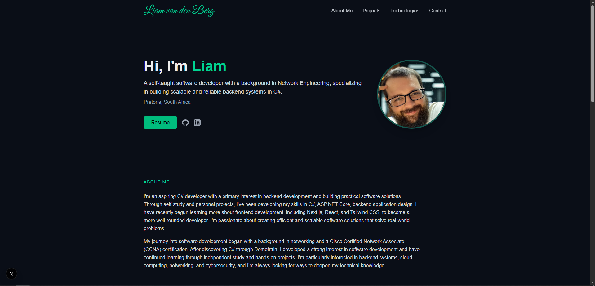

# Portfolio Website

<div align="center">
  <p>A personal portfolio showcasing my projects, technical interests, and development journey.</p>
  <p>
    <strong>Live site:</strong>
    <a href="https://liamvandenberg.dev">liamvandenberg.dev</a>
  </p>
  <p>
    
    
    
    
  </p>
</div>

## Preview



## About

This repository contains the source code for my personal developer portfolio. The site introduces me, highlights selected projects, outlines the technologies I'm learning and using, and provides ways to get in touch.

The design uses a dark theme with emerald accents and is built as a small, component-based Next.js application. The site is planned to be hosted at **[liamvandenberg.dev](https://liamvandenberg.dev)**.

## Features

- **Introduction and about section** — a little about my background and interests.
- **Project showcase** — project cards with previews and links, with project details kept in a separate data file.
- **Project case study** — a dedicated page for the Barkley & Mewton business website project, including its design decisions, challenges, testing, and lessons learned.
- **Technology overview** — technologies grouped into backend, DevOps, and frontend categories.
- **Resume access** — a route for viewing my CV.
- **Contact section** — links to GitHub and LinkedIn, plus a button to copy my email address.
- **Responsive layout** — designed to work across different screen sizes.

## Tech Stack

| Technology | Use |
| --- | --- |
| [Next.js](https://nextjs.org/) | React framework and application routing |
| [React](https://react.dev/) | UI components |
| [TypeScript](https://www.typescriptlang.org/) | Typed JavaScript |
| [Tailwind CSS](https://tailwindcss.com/) | Styling and responsive layouts |
| [React Icons](https://react-icons.github.io/react-icons/) | Technology and interface icons |
| [pnpm](https://pnpm.io/) | Package management |

## Run Locally

### Prerequisites

- [Node.js](https://nodejs.org/)
- [pnpm](https://pnpm.io/)

### Setup

1. Clone the repository:

   ```bash
   git clone https://github.com/liamvandenberg/PortfolioWebsite.git
   cd PortfolioWebsite
   ```

2. Install dependencies:

   ```bash
   pnpm install
   ```

3. Start the development server:

   ```bash
   pnpm dev
   ```

4. Open [http://localhost:3000](http://localhost:3000) in your browser.

### Available Commands

| Command | Description |
| --- | --- |
| `pnpm dev` | Start the local development server |
| `pnpm build` | Create a production build |
| `pnpm start` | Run the production server after building |
| `pnpm lint` | Run ESLint |

## Project Structure

```text
app/
  page.tsx                 # Main portfolio page
  barkleyandmewton/        # Barkley & Mewton project case study
  resume/                  # Resume route
components/                # Reusable page and UI components
  casestudies/             # Components used in the project case study
data/
  projects.ts              # Portfolio project cards and links
  barkleyandmewtondata.tsx # Case study content
public/
  images/                  # Profile, project, and other site images
```

## Adding a Project

The project cards on the home page are defined in `data/projects.ts`. Add a new project object with its title, description, image path, and destination link to include another project in the showcase.

## License

See [LICENSE](LICENSE) for details.
